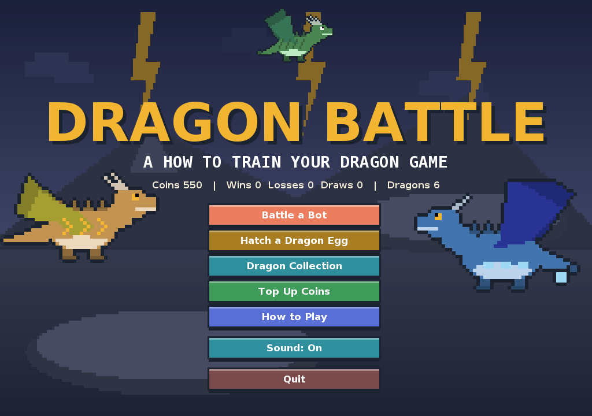

# HTTYD Dragon Battle

A turn-based, Pokémon-style battle game themed on *How to Train Your Dragon*, written in **Java 21+ / Swing**.
Course project for 2110215 Programming Methodology. Fight a bot on three difficulty levels, hatch dragon eggs
(IV + Nature + Alpha), fuse duplicates for stars, battle on 7 battlefields, use trainer items, race the
turn clocks, and top up coins from a free demo shop. Progress is saved automatically.



## How to run

You need **JDK 21 or newer** (the Gradle wrapper downloads a JDK 25 toolchain on the first build).

| Task | macOS / Linux | Windows |
|---|---|---|
| Play the game | `./gradlew run` | `gradlew.bat run` |
| Run the tests | `./gradlew test` | `gradlew.bat test` |
| Build the jar | `./gradlew jar` | `gradlew.bat jar` |
| Build the JavaDoc | `./gradlew javadoc` | `gradlew.bat javadoc` |

After `./gradlew jar` you get `build/libs/httyd-battle.jar`. Copy it to any folder and run:

```
java -jar httyd-battle.jar
```

There are no external libraries; everything is inside the jar. The save file lives at `~/.httyd-battle/save.txt`.

## Documentation

- [User manual](docs/user-manual.md)
- [Design notes: OOP summary for the report](docs/design-notes.md)
- [10-minute presentation script](docs/presentation-outline.md)
- UML diagrams: [`docs/uml/`](docs/uml) (generated from the compiled classes by `docs/uml/make_uml.py`)
- JavaDoc: [`docs/javadoc/index.html`](docs/javadoc/index.html). Enable GitHub Pages on the `/docs` folder and the link becomes
  `https://<user>.github.io/<repo>/javadoc/`

## Code layout

```
src/main/java/httyd/
  model/   dragon, skill (MoveEffect, PassiveSkill), item, field, player   <- data and rules, no GUI
  battle/  BattleEngine, Combatant, DamageCalculator, BattleClock ...     <- battle engine, no GUI
  bot/     BotStrategy + Random / Greedy / Smart
  data/    DragonRepository, GachaService, Profile, CoinPack, SaveManager
  gui/     Swing: every screen, plus code-generated sprites and sounds
  app/     Main
src/main/resources/data/dragons.csv     <- 28 dragons
src/test/java/httyd/                    <- JUnit 5 (151 tests)
```

## Coins and the demo shop

Every player starts with 100 coins. Eggs cost 50. The **Top Up Coins** screen (main menu, or the
"Not enough coins" button on the Egg screen) offers four packs: 100, 500, 1,000 and 5,000 coins.
Pressing a pack adds the coins immediately. It is a demo shop: **no real money is charged or needed.**
The balance is capped at 999,999 coins.

## Sprites and sounds

The images and sounds are currently placeholders generated by code. To use real files, drop them into
`src/main/resources/` and no code change is needed:

- `sprites/<id>.png` where `<id>` is the first column of `dragons.csv` (for example `toothless.png`; 48x36 recommended, facing right)
- `sounds/<name>.wav` where the name is one of `click, hit, crit, dodge, heal, faint, win, lose, egg_crack, egg_open, ultimate, status` (the background music is always generated)

## Team rules

1. Do not change the Java/Gradle version on your own branch without telling the team.
2. Do not commit `build/`, `.gradle/` or `.idea/` (already covered by `.gitignore`).
3. Set your IDE to use the Gradle wrapper and JDK 25 (IntelliJ: Settings > Build Tools > Gradle).
