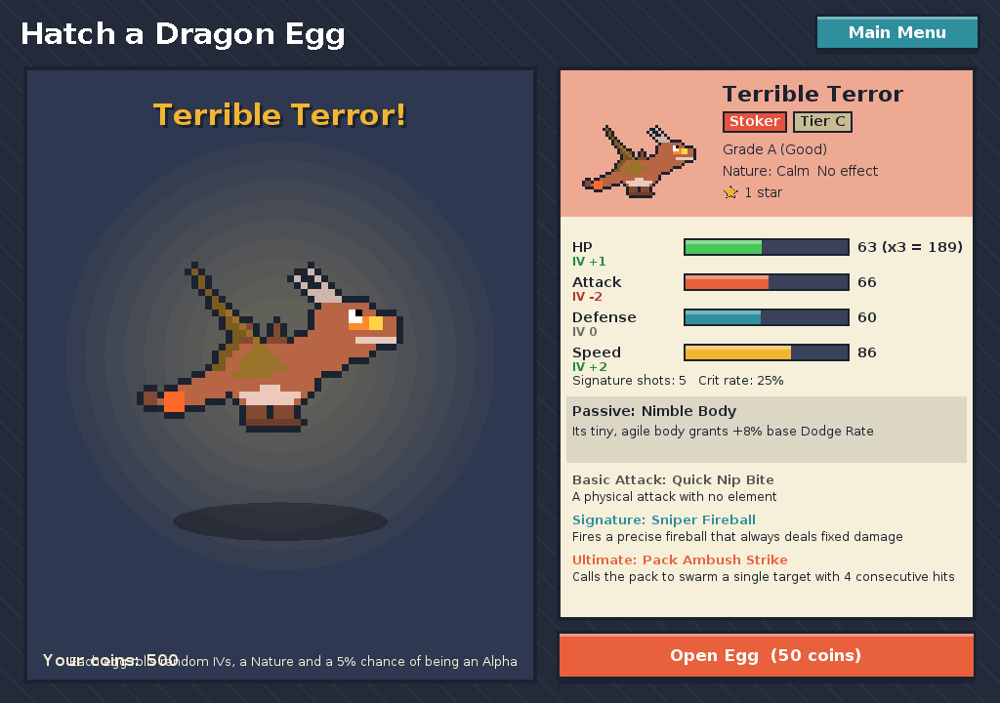
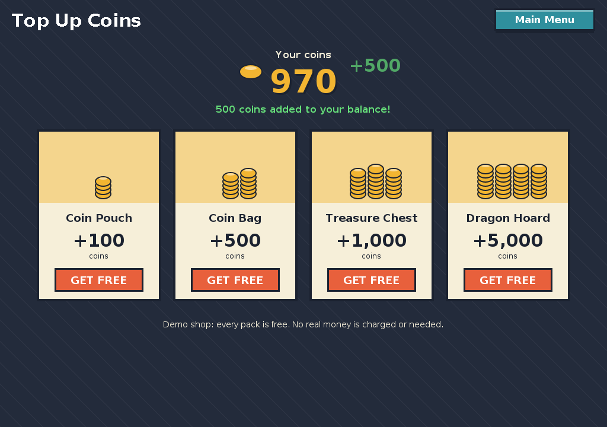
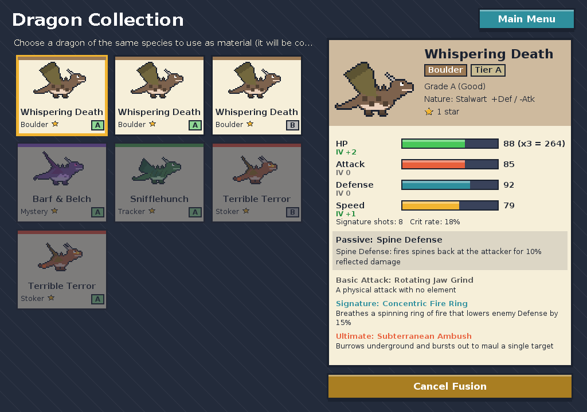
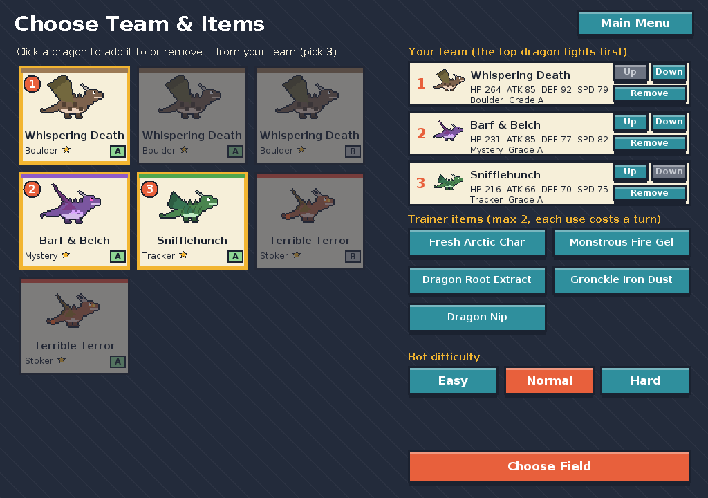
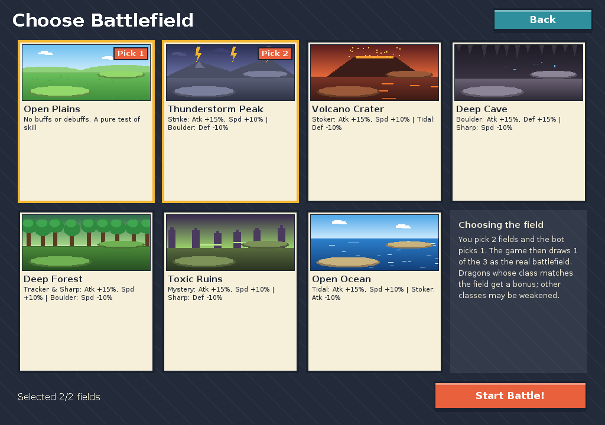
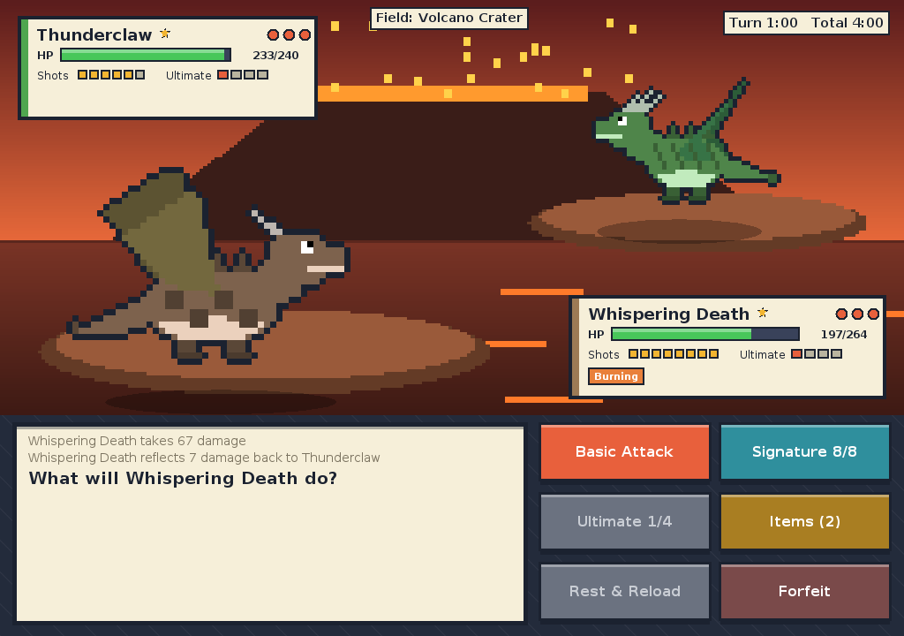
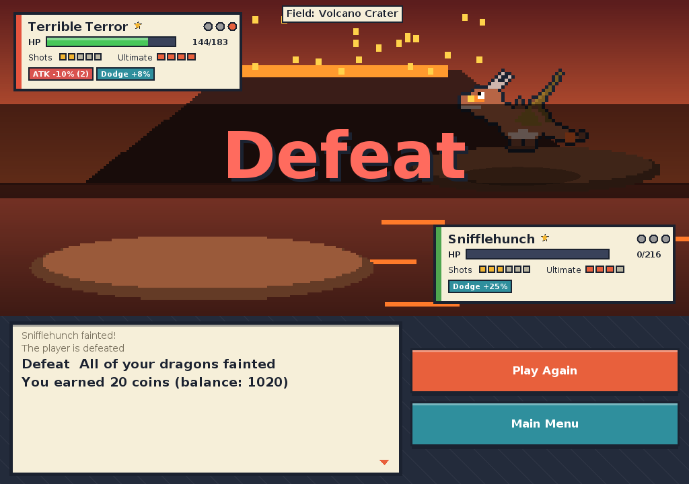

# User Manual: HTTYD Dragon Battle

## 1. Starting the game

Run `java -jar httyd-battle.jar` (JDK 21 or newer). The main menu appears. The game creates its save file at
`~/.httyd-battle/save.txt`. On the first launch you get **100 coins and 3 starter dragons**.

| Button | What it does |
|---|---|
| Battle a Bot | Choose a team, choose battlefields, then fight |
| Hatch a Dragon Egg | Spend 50 coins on a random new dragon |
| Dragon Collection | View your dragons and fuse duplicates for stars |
| Top Up Coins | Free demo shop: get coins instantly, no real money |
| How to Play | In-game summary of the rules |
| Sound: On / Off | Toggle sound |
| Quit | Close the game |

## 2. Hatching eggs

Press "Open Egg". The egg shakes and cracks. Each dragon gets a random:

- **Species**, by tier (C 45% / B 30% / A 18% / S 7%)
- **IV** for HP, Attack, Defense and Speed (-3 to +4 each), which gives a **grade**: B (Common), A (Good) or SSS (Perfect)
- **Nature**, for example Fierce (+Atk / -Def)
- A 5% chance to be an **Alpha** (+5 to every stat)

If you cannot afford an egg, the button changes to "Not enough coins - Top Up" and takes you to the shop.

## 3. Top Up Coins

Open **Top Up Coins** from the main menu. Four packs are shown:

| Pack | Coins |
|---|---|
| Coin Pouch | +100 |
| Coin Bag | +500 |
| Treasure Chest | +1,000 |
| Dragon Hoard | +5,000 |

Press **GET FREE** on a pack and the coins are added to your balance straight away (the counter animates up and a
"+N" appears). You can press as often as you like. This is a demo shop, so **no real money is charged or needed**.
The balance stops at 999,999 coins.

## 4. Collection and fusion

Click a dragon to see its stats, moves and passive. If you own **two or more of the same species**, the
"Fuse with a duplicate" button becomes available: pick the dragon to sacrifice (it is removed) and the main
dragon gains +1 star.

- 2 stars: HP +5% and +1 shot for the signature move
- 3 stars: **Titan Wing**, the passive becomes 50% stronger

## 5. Preparing a battle

1. **Pick 3 dragons** (click the cards). Dragon 1 fights first; use Up / Down to reorder.
2. **Trainer items**, up to 2: Fresh Arctic Char (heals), Monstrous Fire Gel (reloads shots), Dragon Root Extract (+Atk),
   Gronckle Iron Dust (+Def), Dragon Nip (cleanses status effects).
3. **Bot difficulty**: Easy / Normal / Hard. Harder bots field rarer dragons and play smarter.
4. **Choose 2 battlefields** out of 7. The bot picks 1, and the game draws 1 of the 3 as the real battlefield.

## 6. The battle screen

- The top-left box is the bot and the bottom-right box is you. Each shows HP, shots, ultimate charge and status effects (burn, poison, buffs, debuffs).
- The clock in the top-right corner gives **60 seconds per turn** and **4 minutes per match**. Running out of time loses the match (the clock pauses during animations).

| Button | Effect |
|---|---|
| Basic Attack | Typeless, unlimited use |
| Signature | Stronger, can inflict status effects, costs 1 shot |
| Ultimate | Needs 4 charge points (you gain 1 when you hit and 1 when you are hit). The battlefield changes to your dragon's home terrain for 2 turns |
| Items | Use one item; it costs your turn |
| Rest & Reload | Skip the attack and regain 2 shots |
| Forfeit | Lose immediately |

When a dragon faints, pick the next one. "Skip >>" skips animations, and clicking the message box advances the text.

**Rewards:** win 60 coins, draw 25, loss 20. Progress is saved automatically.

## 7. Rules and formulas

- Damage = Atk x 100 / (100 + Def) x move power x type multiplier (x1.25 / x0.8) x critical (x1.5)
- Dodge chance = Speed difference / 4 percent (max 25%, 40% including bonuses)
- The faster dragon acts first
- If the match is still going after 140 actions, the side with more HP remaining wins

### Type chart

Strike > Boulder, Tidal | Boulder > Sharp, Mystery | Sharp > Stoker, Strike | Stoker > Tracker, Mystery |
Tracker > Boulder, Strike | Tidal > Stoker, Tracker | Mystery > Sharp, Tidal

## 8. Troubleshooting

| Problem | Fix |
|---|---|
| `UnsupportedClassVersionError` | Your JDK is older than 21. Install JDK 21 or newer |
| No sound | The machine has no audio device. The game still works |
| Want to start over | Close the game and delete `~/.httyd-battle/save.txt` |
